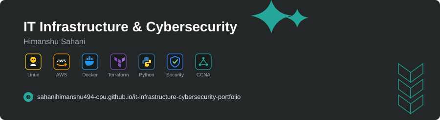

  

  
  
  

### About me ☕

- 🎓 Holding a **Diploma in Computer Networking & Cyber Security** and **ADCA**, with practical training in **CCNA, Linux, Windows Server, and AWS**.
- 🛡️ Focused on **Network Reconnaissance & VAPT**, **Cloud Infrastructure Security (Terraform & AWS)**, and **Enterprise Network Segmentation**.
- 🔬 Building reproducible, evidence-backed labs on Kali Linux with automated reporting and hardening documentation.
- 🚀 Open to **IT Support, Network Support, Junior SysAdmin, and Cybersecurity** opportunities across India.

---

### Featured Hands-On Labs 📌

- 🔐 **[Enterprise Network Reconnaissance, CVSS v3.1 VAPT & Segmentation Hardening](https://github.com/sahanihimanshu494-cpu/it-infrastructure-cybersecurity-portfolio/tree/main/network-recon-vapt-lab)** — *Nmap NSE, Python CVSS Parser, Docker Subnet Isolation*
- ☁️ **[AWS Secure Infrastructure & Monitoring Lab](https://github.com/sahanihimanshu494-cpu/it-infrastructure-cybersecurity-portfolio/tree/main/aws-secure-infrastructure-lab)** — *Modular Terraform IaC, Custom VPC, IMDSv2 EC2, SNS Alerts, Bash Diagnostics*
- 🌐 **[Small-Office Segmented Enterprise Network Design](https://github.com/sahanihimanshu494-cpu/it-infrastructure-cybersecurity-portfolio/tree/main/small-office-vlan-lab)** — *VLSM IP Plan, 802.1Q VLANs, Router-on-a-Stick, Port Security*

---

  
  

